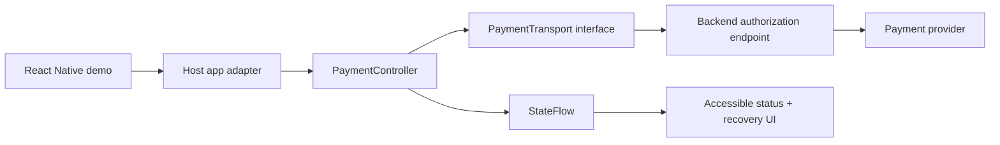

# Mobile Payment SDK Demo

A Kotlin Android payment SDK core with a React Native/Expo client that demonstrates secure transaction state handling, stable idempotency, retry discipline, and explicit customer-action recovery.

## Scope

This repository implements the client-side contract and a deterministic demo transport boundary. It does not process real funds. A production adapter would connect `PaymentTransport` to a provider through a backend tokenization endpoint; secret keys must never ship in the mobile binary.

## Architecture



## Structural overview

```text
sdk/src/main/kotlin/com/clearpay/sdk/
  PaymentModels.kt       validated request and state contracts
  PaymentController.kt   retry/backoff, cancellation, idempotency boundary
sdk/src/test/...         coroutine tests for transient and permanent failures
rn-client/
  App.tsx                cross-platform demo flow
```

## Workflow

1. The host app creates a `PaymentRequest` with an amount, currency, merchant reference, and idempotency key.
2. `PaymentController` emits `Authorizing(attempt)` and sends the same request key for retries.
3. A transient rejection uses bounded exponential backoff; permanent rejection stops immediately.
4. `ActionRequired` pauses for customer verification instead of silently retrying; the host resumes with `confirmCustomerAction()` after its provider challenge UI completes.
5. The UI observes a single `StateFlow` and renders a receipt only after `Succeeded`.

## Design decisions

The transport is an interface so network policy, certificate pinning, and provider SDKs remain outside the state machine. A sealed state model prevents impossible UI combinations. Retry is limited to explicitly retryable failures; changing the idempotency key during a retry would risk duplicate authorization, so the controller preserves it for the entire attempt.

The SDK uses Kotlin coroutines and `StateFlow` because payment state is asynchronous and lifecycle-aware. A callback-only API was avoided because it is easier for host apps to leak callbacks across configuration changes.

## Run the Android tests

From Android Studio, open the repository and run the `sdk` unit-test task. On a machine with Gradle installed:

```bash
gradle :sdk:test
```

Run the demo client:

```bash
cd rn-client
npm install
npx expo start
```

## Production hardening checklist

The Expo web client is configured for Vercel with `npx expo export --platform web` and the `rn-client/dist` output directory.

- Keep provider secrets server-side and exchange only short-lived client tokens.
- Add certificate pinning where supported by the host app's threat model.
- Persist only opaque transaction identifiers; never log PAN or CVV.
- Verify webhook signatures on the backend and reconcile asynchronous settlement.
- Add device attestation and an explicit customer-consent screen for high-risk actions.
